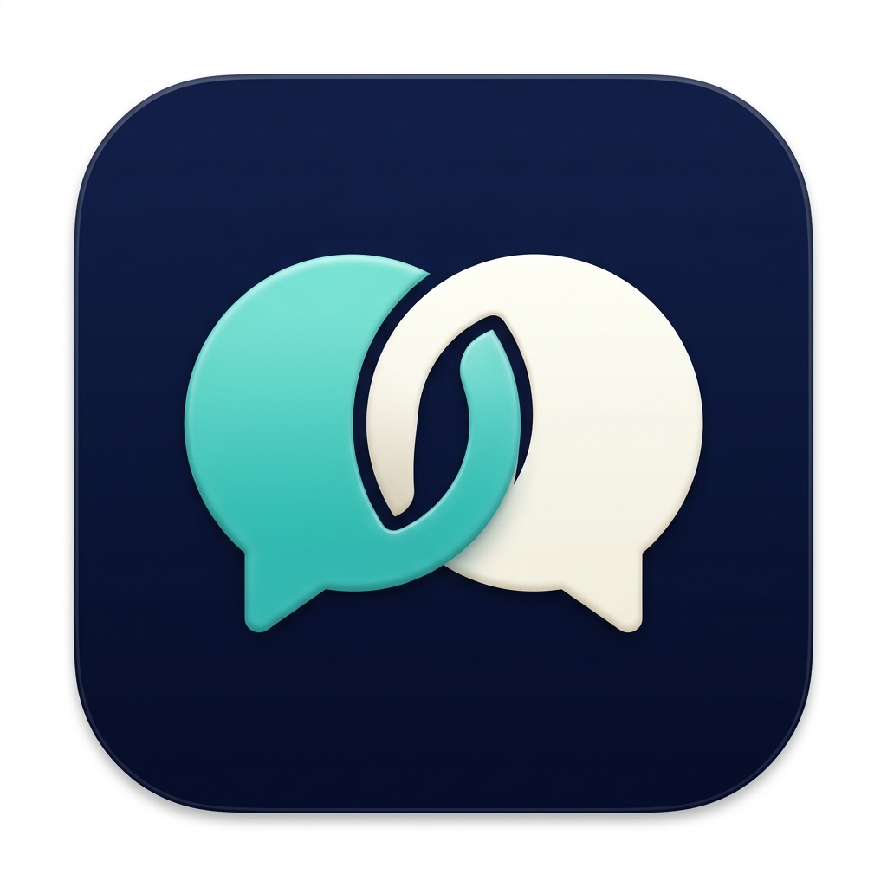

<p align="center">
  
</p>

<h1 align="center">Temada</h1>
<p align="center">Suhbatni kuzating. Tarjimani tushuning.</p>
<p align="center"><b>macOS 14+ · EN / RU / UZ · Rust + Swift</b></p>

> 🧪 **Sinov versiyasi.** Real uchrashuvdagi aniqlik, tezlik va barcha ilovalarda ishlash hali to‘liq tasdiqlanmagan.

## ✨ Nima qiladi?

| | Imkoniyat |
|---|---|
| 🎧 | Meet, Zoom, video va boshqa ilovalarning **tizim ovozidan** transkript va tarjima. |
| 🎙️ | Mikrofon yoki tizim ovozi; **Both** — ikkalasi birga. |
| 💬 | Kichik oynada asl matn va tarjima; tarixni yuqoriga scroll qilib o‘qing. |
| ⌨️ | O‘zbekcha gapiring → inglizcha matnni kursor turgan joyga kiriting. Shortcutni o‘zingiz tanlang. |
| 📝 | Uchrashuv matnini **JSONL + Markdown** fayllariga saqlang. |
| 🎨 | Shrift, rang va oyna o‘lchamini moslang. Trayda Temada logosi. |

**Model yuklab olish shart emas.** Audio Google Gemini API orqali qayta ishlanadi; internet kerak.

## 🚀 Boshlash

1. **Temada → Settings** ni oching, Gemini API key kiriting.
2. **Audio** manbasi va tarjima tilini tanlang.
3. **Request access** orqali kerakli macOS ruxsatlarini bering, **Check again** bosing.
4. Cloud/API xarajatlari roziligini belgilang → **Start captions**.
5. Tugatish uchun tray menyusidan **Stop captions** bosing.

💡 **Both** uchun quloqchin tavsiya etiladi: aks-sado va takroriy matn kamayadi.

### ⌨️ Ovozdan inglizcha matn

**Settings → Uzbek → English at your cursor → Record shortcut… → Enable.**
Mikrofon va Accessibility ruxsati kerak. Matn maydoniga kursor qo‘ying, shortcutni bosing,
**Listening** holatini kutib gapiring; tugatish uchun yana bosing. Send/Enter bosilmaydi.
macOS band qilgan shortcutlar va ayrim matn maydonlari ishlamasligi mumkin.

## 🔒 Maxfiylik va xarajatlar

- **Gemini API alohida hisoblanadi** — ChatGPT/Gemini obunasi API xarajatlarini qoplamaydi. Bepul ishlashi kafolatlanmaydi.
- Audio Googlega yuboriladi. Eshitilmaydigan yaratilgan audio ham hisoblanishi mumkin; **Both** ikki sessiya ochadi. Ishtirokchilar roziligini oling.
- API key faqat shu ishga tushirish davomida xotirada turadi; ilovani qayta ochganda yana kiritasiz.
- Audio diskka yozilmaydi. **Meeting files** bo‘limida saqlash yoqilgan bo‘lsa, matn shifrlanmagan fayllarda saqlanadi — xususiy papka tanlang.
- Tarmoq, kvota yoki xavfsizlik limitlari sessiyani to‘xtatishi mumkin. Tarjima va jumlalar mosligi kafolatlanmaydi.

## 🛠️ Manbadan yig‘ish

macOS 14+, Xcode Command Line Tools, Rust/Cargo va mavjud tasdiqlangan Apple Development sertifikati kerak.
Sertifikat SHA-1 qiymatini quyidagi o‘rinbosar o‘rniga yozing:

```sh
export MC_CODESIGN_IDENTITY="YOUR_APPROVED_CERTIFICATE_40_HEX_SHA1"
bash scripts/build-native.sh
open "dist/Temada.app"
```

Build mavjud `.app` ustiga yozmaydi; yangi chiqish yo‘li uchun `MC_NATIVE_APP` belgilang.
O‘rnatilgan ilovani yangilashdan oldin uni yoping va zaxiralang.

## 📚 Batafsil

[Texnik qo‘llanma, testlar va cheklovlar](docs/TECHNICAL.md) ·
[Shortcut](SHORTCUT-VERIFICATION.md) · [Scroll va uzluksiz sessiya](CONTINUOUS-SCROLL-VERIFICATION.md)
